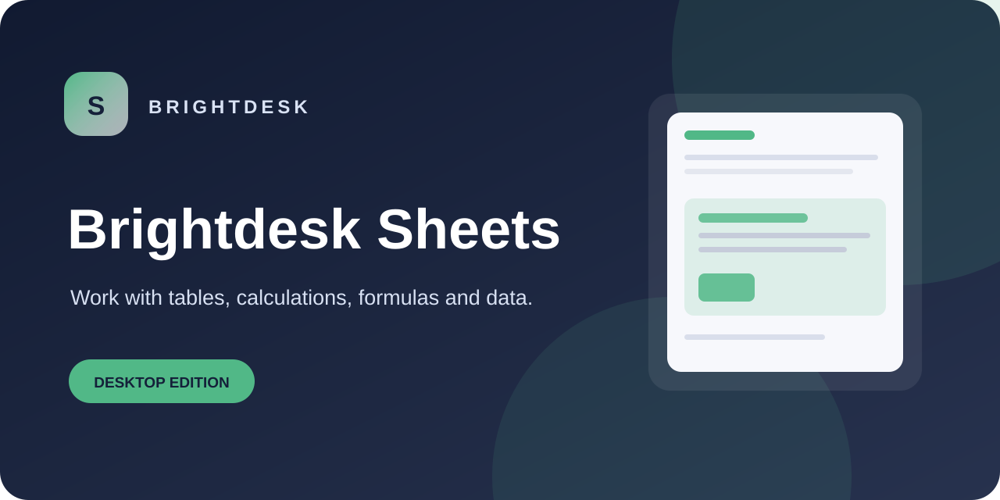

# Brightdesk Sheets

Work with tables, calculations, formulas and data.

Brightdesk is an independent desktop product. This repository is the dedicated desktop version of **Brightdesk Sheets**. It uses the shared Brightdesk desktop engine and opens directly into this product, with product switching disabled.

## What this product does

Work with tables, calculations, formulas and data.

## Download

The latest desktop installers are published from this repository’s verified release workflow when a release is approved.

| Platform | Installer |
| --- | --- |
| Windows | Windows x64 installer (.exe) |
| macOS | Universal installer (.dmg), package (.pkg) and archive (.zip) |
| Linux | x64 AppImage and Debian package (.deb) |

The complete ten-product desktop suite remains available from [Brightdesk-suite](https://github.com/connormolloy12/Brightdesk-suite).

## Quality and security

Pull requests and pushes run the product and shared-engine test suite, verify the dependency lock and third-party licences, check release preflight and block high-severity dependency vulnerabilities. The same checks repeat daily. Dependabot checks npm packages and GitHub Actions weekly.

Installer builds are started manually. Publishing a GitHub Release is a separate manual choice and is disabled by default.

## Run from source

Use Node.js **24.22.2**.

    npm ci
    npm start

To build an installer on its native operating system:

    npm run dist:product:mac
    npm run verify:product:mac

Use win on Windows or linux on Linux instead of mac.

## Project structure

- src/ — Brightdesk desktop renderer and product modules.
- assets/brightdesk-product.svg — original product artwork.
- scripts/ — build and release verification tools.
- tests/ — automated product and shared-engine tests.

## Related project

[Brightdesk Office Suite](https://github.com/connormolloy12/Brightdesk-suite) brings all ten approved Brightdesk products together in one desktop installer.

## Identity and licence

Brightdesk is independent and is not affiliated with Microsoft. It uses original product names, code, interface design and artwork. See LICENSE, TERMS_AND_CONDITIONS.txt and THIRD_PARTY_NOTICES.md.
