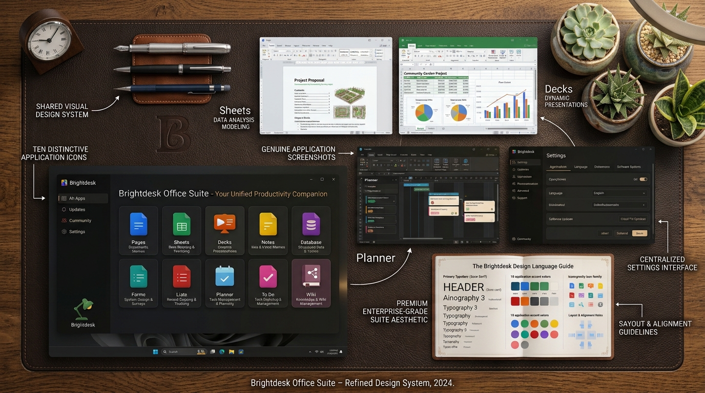

# ️ Brightdesk Office Suite
> **Refined Design System & Unified Productivity Companion**

Brightdesk is an enterprise-grade office productivity suite featuring 10 core applications built on a shared, unified visual design system.

---

##  Design System & Core Architecture

* **Shared Visual Design System:** Standardized typography, component hierarchy, and layout guidelines across all tools.
* **Unified Accent Colors:** Distinct, recognizable accent identity for each application within the suite.
* **Centralized Settings Interface:** Streamlined application configuration, updates, theme customization, and preference management.

---

##  The 10 Applications

| App Icon | Application | Purpose & Focus |
| :---: | :--- | :--- |
|  | **Pages** | Document processing, drafting, and memos |
|  | **Sheets** | Data analysis, modeling, and financial reporting |
|  | **Decks** | Dynamic presentations and slideshow creation |
|  | **Notes** | Web clippings, quick notes, and ideas |
| ️ | **Database** | Structured data storage and custom tables |
|  | **Forms** | System design, surveys, and data collection |
|  | **Lists** | Item tracking, catalogs, and logs |
|  | **Planner** | Task management, roadmapping, and scheduling |
| ✅ | **To Do** | Task tracking and personal agenda management |
|  | **Wiki** | Knowledge bases and team wiki documentation |

---

*Brightdesk Office Suite — Refined Design System, 2024.*
