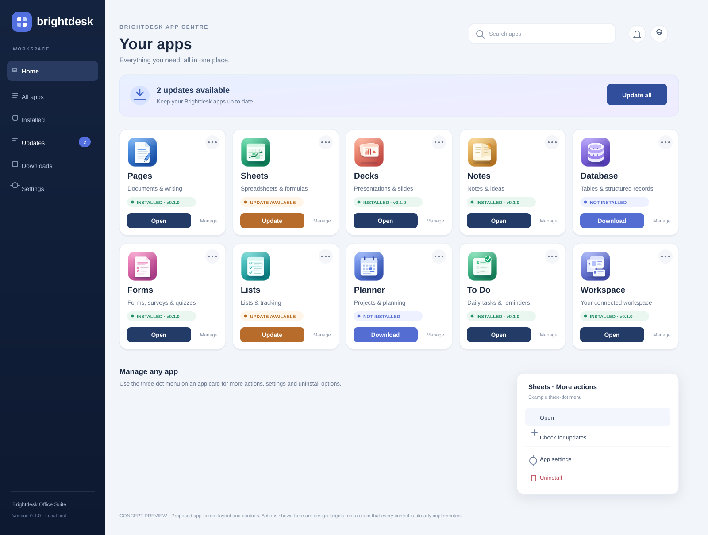

  

# Brightdesk Office Suite

Brightdesk is an independent native desktop productivity suite. It is not affiliated with Microsoft.

## See Brightdesk

The following artwork gives the project a visual identity and provides an early look at the planned desktop experience.

  

> **Important:** This is a concept illustration, not a screenshot of a completed application build. It shows the intended dashboard direction. Actual screens and workflows must be captured from the running app as implementation and acceptance testing progress.

## The ten Brightdesk applications

Each application has its own icon and purpose. All ten remain part of the approved suite.

| Application | Icon | Purpose |
| --- | :---: | --- |
| **Pages** |  | Write and format documents. |
| **Sheets** |  | Build spreadsheets, formulas and tables. |
| **Decks** |  | Create slide presentations. |
| **Notes** |  | Keep notes and ideas together. |
| **Database** |  | Organise records, tables and structured data locally. |
| **Forms** |  | Create surveys, quizzes and collect responses locally. |
| **Lists** |  | Track projects, inventories and records locally. |
| **Planner** |  | Plan work, tasks and progress locally. |
| **To Do** |  | Manage daily tasks, due dates and priorities. |
| **Workspace** |  | Bring project notes, tasks and resources together locally. |

## How Brightdesk works

1. **Install:** Choose the installer for Windows, macOS or Linux. End users do not need to install Node.js or Rust.
2. **Open:** Launch Brightdesk from your Applications folder, Start menu or desktop environment.
3. **Choose an app:** Select one of the ten app cards from the Brightdesk home screen.
4. **Work locally:** Use the selected application. The first release is local-first; it does not claim cloud collaboration or Microsoft service integration.
5. **Update when ready:** Brightdesk can check for updates when configured. It never downloads or installs an update without the customer's choice.

## First release

Version 0.1.0 contains the complete ten-app Brightdesk catalogue and integrated app modules. All ten apps remain visible in the suite.

Brightdesk is the ten-app desktop suite, with all ten approved apps implemented in the integrated codebase.

## Official product version

**The first official customer-facing Brightdesk release is 0.1.0.** The root `package.json` is the single source of truth. The desktop app, all ten app modules, installer filenames, release notes and download metadata must use that same version. Internal development numbers are never customer release numbers. Future customer updates must update the package manifest and lockfile together. See [the versioning policy](docs/VERSIONING.md).

| App | What it does | Implementation status |
| --- | --- | --- |
| Brightdesk Pages | Write and format documents. | Integrated |
| Brightdesk Sheets | Build spreadsheets, formulas and tables. | Integrated |
| Brightdesk Decks | Create slide presentations. | Integrated |
| Brightdesk Notes | Keep notes and ideas together. | Integrated |
| Brightdesk Database | Organise records, tables and structured data locally. | Integrated |
| Brightdesk Forms | Create surveys, quizzes and collect responses locally. | Integrated |
| Brightdesk Lists | Track projects, inventories and records locally. | Integrated |
| Brightdesk Planner | Plan work, tasks and progress locally. | Integrated |
| Brightdesk To Do | Manage daily tasks, due dates and priorities. | Integrated |
| Brightdesk Workspace | Bring project notes, tasks and resources together locally. | Integrated |

All ten approved app modules are present in the integrated suite, with dedicated feature code and automated integration coverage. “Integrated” describes the current codebase; it does not mean every workflow, accessibility scenario, data migration, installer or operating-system build has passed final acceptance testing.

The first release remains local-first; the suite does not claim cloud collaboration or Microsoft service integration.

## Quality verification

The automated test suite includes service tests, app-shell integration tests and DOM-contract checks for the integrated workspaces. Database supports ascending and descending record sorting, and CSV export prefixes formula-like text values so spreadsheet programs are less likely to interpret user-entered text as formulas. These checks help protect module-to-shell connections and core logic; they do not replace real app interaction, data-persistence, accessibility, cross-platform build, installation, upgrade or uninstall testing.

### Current verification — 4 November 2026

Brightdesk-suite PR #38 has been merged into main at commit `887515e5348e7c005ed3d32d20f32a97998f2c87`.

- The [Rust Node-API engine check](https://github.com/connormolloy12/Brightdesk-suite/actions/runs/41797522160) passed on the existing self-hosted Mac runner. Formatting, Clippy, Rust tests, native addon build and Node-API/embedding bridge tests passed.
- The [security and dependency audit](https://github.com/connormolloy12/Brightdesk-suite/actions/runs/41797522120) passed on the self-hosted runner.
- The installer preparation, lockfile-generation and third-party-notices jobs did not execute their steps on GitHub-hosted runners. They remain blocked by the existing hosted-runner allocation issue tracked in [Brightdesk-suite issue #23](https://github.com/connormolloy12/Brightdesk-suite/issues/23). These are runner-start failures, not evidence that installer builds or application tests failed.
- The Windows and Linux installer paths have not been verified by this post-merge run. The Mac Rust check verifies the native engine only; it is not a complete macOS installer acceptance test.

No customer release was published and no installer bundle was produced by these checks. Brightdesk is not yet release-ready across all three operating systems.

## Supported installer targets

The release workflow is designed to build macOS universal DMG, PKG and ZIP packages, Windows x64 EXE installers, and Linux x64 AppImage and DEB packages. A platform build is only considered ready after its artifacts, legal documents and SHA-256 checksums have been verified. No public release should be published without explicit owner approval.

## Standalone app builds

The shared suite can also build each of the ten approved product editions separately. To build all ten for one operating system, use:

- Windows: `npm run dist:apps:win`
- macOS: `npm run dist:apps:mac`
- Linux: `npm run dist:apps:linux`

Individual commands are available as `npm run dist:<product>:<platform>` for Pages, Sheets, Decks, Notes, Database, Forms, Lists, Planner, To Do and Workspace. Each standalone installer includes the native Rust Node-API engine. The batch command builds that engine once before producing the ten installers.

## Installing Brightdesk

**End users do not need to download or install Node.js.** The native desktop application is packaged with the Electron runtime it needs. Install Brightdesk using the installer for your operating system and open it like any other desktop app. See [INSTALLATION.md](docs/INSTALLATION.md) for instructions.

## Development

Building and testing Brightdesk requires exactly Node.js 24.22.2. This is a developer/CI requirement only; it is not a customer installation requirement. Run `npm run setup:dev` after activating that runtime. The project uses its checked-in package lock and automated Node.js tests.

The consolidated pull-request quality gate uses the existing self-hosted Mac runner to avoid consuming paid GitHub-hosted minutes. It verifies Node.js 24.22.2, the committed dependency lock, licences, app-module syntax, the complete test suite, release preflight and high-severity dependency vulnerabilities. The runner must be online for those checks to start.

The three-platform installer workflow is manual-only. It requires Windows, macOS and Linux build runners; do not dispatch it unless those runners are available. Publishing a GitHub Release remains a separate explicit choice and defaults to off. For local verification, run `npm run verify:local-release` on the target operating system; see [Local release verification](docs/LOCAL-RELEASE-VERIFICATION.md). This local process does not upload or publish anything.

Brightdesk uses original product names, code, artwork and interface design. Microsoft product names are used only as internal workflow comparisons.

## Updates and customer control

Automatic update checking can be turned on or off. Turning it off stops scheduled and focus-triggered checks. Brightdesk never downloads or installs an update automatically; the customer must choose **Download update** and then **Install update**. The release feed is not configured in the current development build, so update checks will remain unavailable until the approved distribution repository is configured.

## Rust native engine

The Electron main process loads a local Rust Node-API module for bounded source processing and provider-neutral embedding operations. Rust is used for normalization, cosine similarity, and ranking of vectors returned by an explicitly configured model provider; it does not create semantic embeddings or call external models. No external model provider, paid API, credential, or remote source upload is enabled. See [Rust Node-API integration](docs/RUST_ENGINE_INTEGRATION.md).
