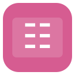

# Brightdesk Suite

**Ten focused desktop products. One consistent Brightdesk experience.**

Brightdesk is an independent, local-first desktop productivity suite. It uses original product names, code, interface design and artwork. It is not affiliated with Microsoft, Adobe or ArtCraft.

## Brightdesk identity

Brightdesk has its own original visual identity: a geometric four-panel mark, a distinctive wordmark, a deep-navy foundation and a cyan-to-violet accent gradient. The identity is recognisable across the Suite and all ten products.

The full logo combines the four-panel symbol with the **brightdesk** wordmark and **OFFICE SUITE** lettering. The standalone application mark is the four-panel symbol without the wordmark. View the [full Brightdesk logo SVG](assets/brand/brightdesk-logo.svg) or the [standalone Suite mark SVG](src/assets/brand/brightdesk-suite-mark.svg).

The Suite's identity belongs in the installed application identity and native application window, not repeated inside the Home artwork. The Home design stays focused on the customer's products and work.

## The Brightdesk Suite experience

The artwork above is the refreshed Home screen design reference. It shows the intended Brightdesk Suite appearance: a narrow, full-height navigation rail on the far left, ten original product cards, and Notifications and Settings controls.

The illustrated rail is **76 px wide** at the 1600 × 900 reference size and runs the full height of the screen. It contains only three vertically stacked navigation buttons: each has its original icon above its name — **Home**, **Apps** and **Files**. **Home** is selected. There are no secondary descriptions, extra sidebar heading, repeated Brightdesk logo or wordmark, divider, or footer in this artwork. The Files icon is an open folder with a visible document stack.

This is Brightdesk’s own design, using its original navy colours, icons and labels while taking the compact far-left navigation-rail proportions as inspiration from Adobe Creative Cloud. In the running Suite, the destinations are actual buttons: **Home** opens the Home view, **Apps** opens product management, and **Files** opens local file access. The artwork is a visual design reference; it does not by itself change the live application layout. The currently implemented desktop sidebar remains 238 px wide and retains its **YOUR WORKSPACE** heading and **Desktop** / **Local-first · Your files stay here** footer. The Suite identity remains in the installed application identity and native application window.

The no-caption treatment applies specifically to Home. The same **Home**, **Apps** and **Files** destinations remain available when moving around the Suite; **Apps** becomes selected on product management and **Files** becomes selected on the local file-access page. Those non-Home views can show short explanatory captions beneath the navigation labels.

When a product workspace is active in the Suite, the Home/Apps/Files navigation is replaced by a contextual **SWITCH PRODUCT** list. It shows other installed products that are enabled for navigation, excluding the active product and products the user has hidden. That product-switching sidebar is contextual and is not part of the Home screen artwork.

The top bar reads **Your apps**. The product grid is headed **Your products** with the line **Ten focused tools, connected by one Brightdesk experience.** The redundant **MY APPS** label is hidden on Home so the section has one clear heading.

The live desktop interface still has its existing 238 px sidebar; the **76 px rail is the target shown in this design artwork**, not yet a change to the running app. The artwork’s main area retains a 34 px Home heading, 38 px circular Notifications and Settings controls, and 240 px product cards with 16 px column and 18 px row gaps. The grid presents five cards per row at this size and adapts to fewer columns on narrower screens.

Home opens to the ten-product grid. Apps opens product management. Files provides local Open file and Save project actions. Product settings let users hide or restore an enabled product in the Suite's **Switch product** list; hiding a product changes navigation visibility only.

The Home artwork is a design reference, not a screenshot of a running release. The live desktop interface should follow this visual direction and remain aligned with the approved artwork.

## The ten Brightdesk products

These are the only products in the approved suite. The ten-product lineup is complete.

| Product | Original icon | Purpose |
| --- | :---: | --- |
| **Brightdesk Pages** |  | Create and format documents, letters and reports. |
| **Brightdesk Sheets** |  | Work with spreadsheets, formulas, calculations and data. |
| **Brightdesk Decks** |  | Create, edit and present slide presentations. |
| **Brightdesk Notes** |  | Capture and organise quick notes and ideas. |
| **Brightdesk Database** |  | Build local tables, define fields and manage records. |
| **Brightdesk Forms** |  | Create forms, preview questions and collect responses locally. |
| **Brightdesk Lists** |  | Organise records with custom columns, search, filters and sorting. |
| **Brightdesk Planner** |  | Organise plans, buckets, tasks, priorities and progress. |
| **Brightdesk To Do** |  | Manage personal tasks, due dates and daily priorities. |
| **Brightdesk Workspace** |  | Bring project pages, notes, checklists and information together. |

Brightdesk-AI is internal development tooling, not an eleventh customer product. Brightdesk-Wiki is the separate online help resource, not a product inside the Suite. Outlook, OneDrive, Teams and other unapproved products are not part of Brightdesk.

## Visual language

The Brightdesk visual language is professional, clear, calm and recognisable across the Suite and all ten products.

### Core colours

| Colour | Hex value | Use |
| --- | --- | --- |
| Deep navy | `#101B35` | Primary identity background and navigation |
| Bright cyan | `#53C8E8` | Primary gradient highlight |
| Violet | `#7868E8` | Primary gradient finish |
| Soft violet | `#8C7CF0` | Supporting identity accent |
| Teal | `#43B9A7` | Supporting identity accent |
| Blue | `#4B8DE8` | Supporting identity accent |
| Ink | `#17233D` | Primary wordmark and heading colour |
| Slate | `#63718B` | Secondary text |

### Typography and layout

- Use a clear sans-serif typeface with strong readability.
- Keep the Brightdesk wordmark visually distinct from product names.
- Use consistent spacing, alignment, corner radii and restrained shadows.
- Give each product its own recognisable accent colour and original icon.
- Keep layouts focused and uncluttered, with clear headings and readable controls.
- Use the same approved visual system across Windows, macOS and Linux; adapt only operating-system conventions where needed.

### Product identity

Use each product's original SVG icon consistently in the Suite Home cards, product navigation, application windows and product artwork. Do not substitute emoji, generic symbols or another product's icon.

Product names must remain exactly: **Pages, Sheets, Decks, Notes, Database, Forms, Lists, Planner, To Do and Workspace**.

## Brand consistency

Brightdesk is written as one word with a capital **B** in normal text. Keep the four-panel Suite mark, wordmark, colour palette, product names and original product icons consistent wherever Brightdesk is presented.

Do not add products, alter approved product names, introduce unrelated visual marks, or place Suite branding inside the Home artwork. The Suite identity and the ten product identities work together as one original Brightdesk family.
