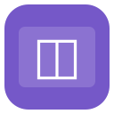

# Brightdesk Office Suite

**Brightdesk is a ten-app desktop suite: ten focused applications, one consistent experience.**

Brightdesk is an independent, local-first desktop productivity suite. Each application has its own original Brightdesk icon, product-specific workspace and accent colour, while sharing a consistent desktop design system.

## The ten applications

| Application | Icon | Purpose |
| --- | :---: | --- |
| **Pages** |  | Create and format documents, letters and reports. |
| **Sheets** |  | Work with spreadsheets, formulas, calculations and data. |
| **Decks** |  | Design slide presentations and deliver presentations. |
| **Notes** |  | Capture and organise notes, pages, sections and ideas. |
| **Database** |  | Build local tables, define fields and manage records. |
| **Forms** |  | Create forms, surveys and collect responses locally. |
| **Lists** |  | Organise inventories, projects and structured records. |
| **Planner** |  | Plan projects, schedules, tasks and progress. |
| **To Do** |  | Manage daily tasks, due dates and priorities. |
| **Workspace** |  | Bring project pages, notes, tasks and resources together. |

Every icon above is original, bundled SVG artwork—not a text character, emoji or placeholder. The same product identity should be used in the launcher, application navigation, window/app metadata and product documentation.

## Visual identity

Brightdesk uses a shared desktop design language with:
- Original, product-specific application icons.
- Distinct accent colours for all ten products.
- Consistent typography, navigation, controls, spacing and focus states.
- Clear local-save and device-management language.
- Product-specific workspaces designed around each application's purpose.

Read the [Brightdesk visual and interaction standard](docs/BRIGHTDESK_VISUAL_STANDARD.md) for the complete design contract.

## Local-first desktop software

Brightdesk is designed to run as installed desktop software and keep user work on the device. It does not require an account or cloud workspace.

## Product repositories

Each application has its own repository and product documentation:

- [Brightdesk Pages](https://github.com/connormolloy12/Brightdesk-Pages)
- [Brightdesk Sheets](https://github.com/connormolloy12/Brightdesk-Sheets)
- [Brightdesk Decks](https://github.com/connormolloy12/Brightdesk-Decks)
- [Brightdesk Notes](https://github.com/connormolloy12/Brightdesk-Notes)
- [Brightdesk Database](https://github.com/connormolloy12/Brightdesk-Database)
- [Brightdesk Forms](https://github.com/connormolloy12/Brightdesk-Forms)
- [Brightdesk Lists](https://github.com/connormolloy12/Brightdesk-Lists)
- [Brightdesk Planner](https://github.com/connormolloy12/Brightdesk-Planner)
- [Brightdesk To Do](https://github.com/connormolloy12/Brightdesk-To-Do)
- [Brightdesk Workspace](https://github.com/connormolloy12/Brightdesk-Workspace)

## Development

Use Node.js **24.22.2 LTS** for all development, testing and release work.

From the repository root:

```sh
npm run check:node
npm ci --no-audit --no-fund
npm test
npm run build
```

The test command runs the Node.js service, interface, packaging and release tests first, followed by the Vitest workspace tests. Network-backed dictionary tests are skipped unless explicitly enabled. Run `npm run release:preflight` before preparing any installer.

See [installation guidance](docs/INSTALLATION.md), [local release verification](docs/LOCAL-RELEASE-VERIFICATION.md) and [versioning](docs/VERSIONING.md) before preparing a release.
## Scope and identity

The approved suite contains exactly the ten applications listed above. Outlook, OneDrive and Teams are excluded. Brightdesk is independent and is not affiliated with Microsoft, Adobe or ArtCraft. Those products are quality references only; Brightdesk uses its own names, code, interface design and artwork.

See [PRODUCT_SCOPE_LOCK.md](PRODUCT_SCOPE_LOCK.md), [LICENSE](LICENSE) and [THIRD_PARTY_NOTICES.md](THIRD_PARTY_NOTICES.md).
