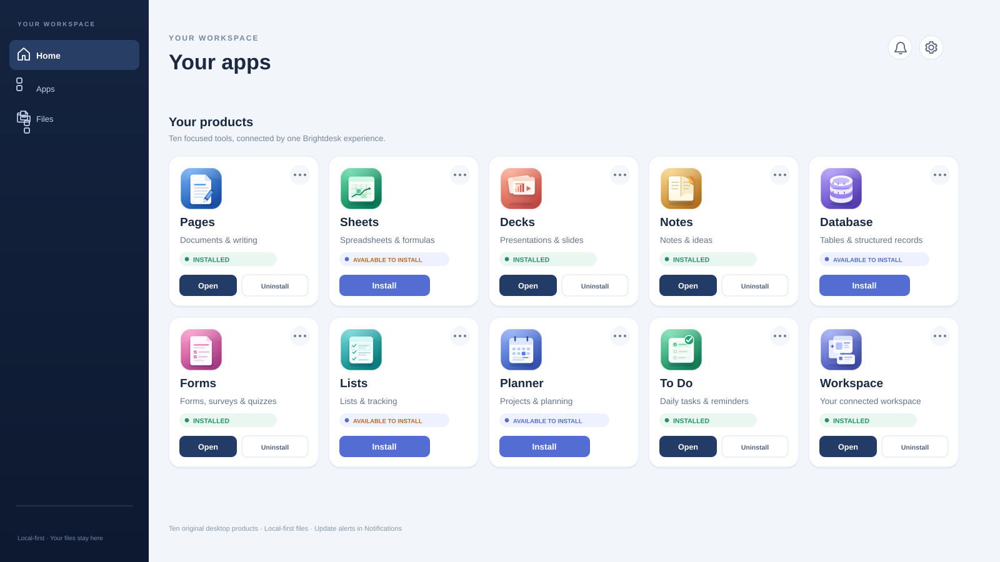

# Brightdesk Suite

  

<strong>Ten focused desktop products. One consistent Brightdesk experience.</strong>

Brightdesk is an independent desktop productivity suite built around an original, consistent identity. The Suite brings ten focused products together in one familiar desktop experience.

## The Brightdesk identity

The Brightdesk identity is the geometric four-panel symbol paired with the Brightdesk wordmark and the **OFFICE SUITE** descriptor. The four coloured panels form one recognisable mark; the wordmark and descriptor complete the Suite identity.

The approved logo is maintained in [assets/brand/brightdesk-logo.svg](assets/brand/brightdesk-logo.svg). Keep its proportions, four-panel construction, colours and wordmark together. Do not replace it with a copyright symbol, a generic letterform, a different badge, or an unrelated product icon.

## The Brightdesk Suite

  

The artwork above is the approved Brightdesk Suite Home design reference. It shows the intended desktop appearance: a deep navy navigation sidebar, a light workspace, clear Home, Apps and Files navigation, ten original product cards, and Notifications and Settings controls.

This is the intended Suite design, not a claim that the artwork is a screenshot of a running release. The application interface should follow this visual direction and remain consistent with the original Brightdesk identity.

## The ten Brightdesk products

These are the ten customer-facing products in the Suite. This list is complete.

| Product | Purpose |
| --- | --- |
| **Pages** | Create and format documents, letters and reports. |
| **Sheets** | Work with spreadsheets, formulas, calculations and data. |
| **Decks** | Create, edit and present slide presentations. |
| **Notes** | Capture and organise quick notes and ideas. |
| **Database** | Build local tables, define fields and manage records. |
| **Forms** | Create forms, preview questions and collect responses locally. |
| **Lists** | Organise records with custom columns, search, filters and sorting. |
| **Planner** | Organise plans, buckets, tasks, priorities and progress. |
| **To Do** | Manage personal tasks, due dates and daily priorities. |
| **Workspace** | Bring project pages, notes, checklists and information together. |

Brightdesk-AI is internal development tooling, not an eleventh customer product. Brightdesk-Wiki is the separate online help resource, not a product inside the Suite.

## Visual language

The Brightdesk visual language is professional, clear, calm and recognisable across the Suite and all ten products.

### Core colours

| Colour | Hex value | Use |
| --- | --- | --- |
| Deep navy | `#101B35` | Primary identity background and navigation |
| Bright cyan | `#53C8E8` | Primary gradient highlight |
| Violet | `#7868E8` | Primary gradient finish |
| Soft violet | `#8C7CF0` | Supporting identity accent |
| Teal | `#43B9A7` | Supporting identity accent |
| Blue | `#4B8DE8` | Supporting identity accent |
| Ink | `#17233D` | Primary wordmark and heading colour |
| Slate | `#63718B` | Secondary text |

### Typography and layout

- Use a clear sans-serif typeface with strong readability.
- Keep the Brightdesk wordmark visually distinct from product names.
- Use consistent spacing, alignment, corner radii and restrained shadows.
- Give each product its own recognisable accent and original icon while preserving the shared Suite design language.
- Keep layouts focused and uncluttered, with clear headings and readable controls.

### Product identity

Use the approved original icon for each product consistently in the Suite Home, product navigation, application windows and product artwork. Product names must remain exactly:

**Pages · Sheets · Decks · Notes · Database · Forms · Lists · Planner · To Do · Workspace**

Do not introduce additional customer products or substitute names.

## Brand asset locations

- [Brightdesk Suite logo](assets/brand/brightdesk-logo.svg) — primary geometric mark, wordmark and Suite descriptor.
- [Brightdesk Suite Home design](assets/product-experience/brightdesk-home.svg) — approved customer-facing desktop design reference.
- [Original product icons](assets/icons/) — the ten product identities used throughout the Suite.

Brightdesk is always written as one word with a capital **B** in normal text. The logo artwork retains its approved wordmark styling. Keep the Brightdesk identity original and consistent wherever the Suite is presented.
