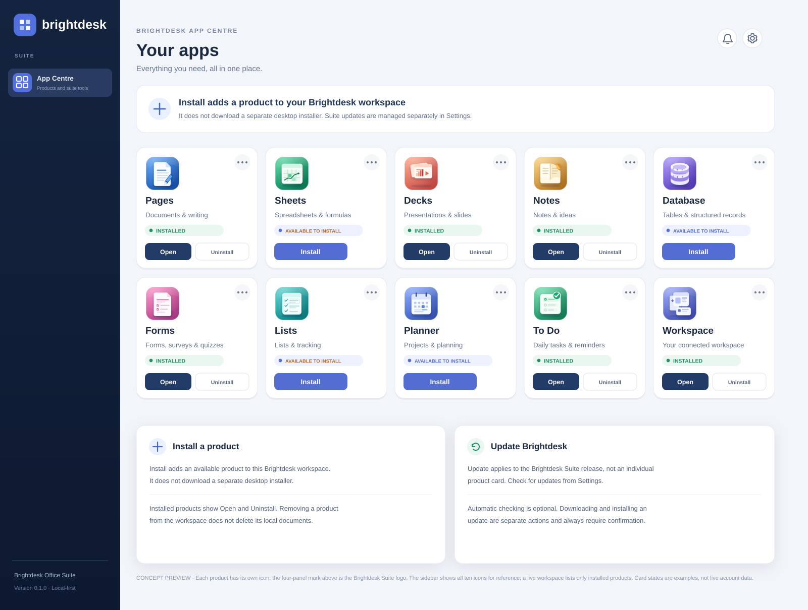

# Brightdesk Office Suite

<p align="center"></p>

<p align="center"><strong>Ten focused desktop products. One consistent Brightdesk experience.</strong></p>

Brightdesk is an independent, local-first desktop productivity suite. It uses original product names, code, interface design and artwork. It is not affiliated with Microsoft, Adobe or ArtCraft.

## The ten approved products

| Product | Original icon | Purpose |
| --- | :---: | --- |
| **Pages** |  | Create and format documents, letters and reports. |
| **Sheets** |  | Work with spreadsheets, formulas, calculations and data. |
| **Decks** |  | Create, edit and present slide presentations. |
| **Notes** |  | Capture and organise quick notes and ideas. |
| **Database** |  | Build local tables, define fields and manage records. |
| **Forms** |  | Create forms, preview questions and collect responses locally. |
| **Lists** |  | Organise records with custom columns, search, filters and sorting. |
| **Planner** |  | Organise plans, buckets, tasks, priorities and progress. |
| **To Do** |  | Manage personal tasks, due dates and daily priorities. |
| **Workspace** |  | Bring project pages, notes, checklists and information together. |

These are the only products in the approved suite. Outlook, OneDrive, Teams and any other unapproved products are excluded.

## Suite design preview

<p align="center"></p>

> **Concept artwork — not a screenshot.** This image communicates the intended Brightdesk visual direction. It is not a capture from the running desktop build.

The preview above shows the corrected layout: one suite-wide Settings cogwheel in the top-right, with Notifications beside it. There is no Settings button or second gear in the left sidebar; that sidebar is for product navigation. The four-panel mark beside the Brightdesk wordmark is the Suite logo, not a product icon. Each approved product has its own original icon, shown beside its name in the preview sidebar and on its product card. The concept displays all ten icons for reference; a running workspace sidebar lists only the products installed in that workspace.

**What the card actions mean:** **Install** adds an available product to the current Brightdesk workspace. It does not download a separate desktop installer. Installed products show **Open** and **Uninstall**; removing a product from the workspace does not delete its local documents. **Update** is different: it applies to the Brightdesk Suite release, not an individual product card. Update checks and preferences are managed in Settings. Automatic checking is optional, and downloading and installing updates require separate confirmation. The current suite has no configured GitHub update publishing provider, so automatic release delivery is not active or verified.

The current App Centre uses direct **Open**, **Uninstall** and **Install** actions. A three-dot **Product settings** menu is not shown as an implemented control in this preview. Product-specific card settings remain a design consideration, not a claim about the current interface. The Save control has a recognisable save icon and a visible label.

## Cross-platform consistency

Brightdesk uses one approved visual system and the same ten-product feature scope on Windows, macOS and Linux. All products share the Brightdesk navigation, typography, spacing, component states, layout rules and original icon artwork. Each product keeps its approved accent colour and icon on every platform. Only operating-system integrations such as window chrome, keyboard conventions, native file dialogs, permissions, installation and removal surfaces may adapt to native conventions. The authoritative rules are in the [Brightdesk visual and interaction standard](docs/BRIGHTDESK_VISUAL_STANDARD.md).

| Operating system | Configured suite package targets |
| --- | --- |
| Windows | x64 NSIS installer (.exe) |
| macOS | Universal disk image (.dmg), package installer (.pkg) and archive (.zip) |
| Linux | x64 AppImage (.AppImage) and Debian package (.deb) |

These are configured targets, not proof that current installers are published or verified. A complete cross-platform release requires successful native build, install, first launch, upgrade and removal checks for every supported operating system, using the same approved suite version and source commit.

**Terms and first launch:** Windows NSIS and macOS DMG/PKG installers present the Terms and Conditions before installation continues. Linux uses the same blocking agreement in the packaged product on first launch, because AppImage has no installer agreement page. The workspace remains unavailable until the user explicitly accepts; declining or closing the agreement exits the product.

**Updates and removal:** The suite owns the customer-facing version and approved release. The current suite package does not configure a GitHub update publishing provider, so automatic cross-platform update delivery is not active or verified. When update delivery is enabled, every platform must receive the same approved version, features and release notes. Operating systems use different native install/removal mechanisms; the required outcome is consistent removal of the software without silently deleting local project data. Do not claim uninstall/data-preservation parity until each native route has passed its checks.

## What is implemented

All ten approved product areas are integrated into the main suite source and have dedicated workspace or service modules. The current first-use scope includes:

| Product | First-use workflows represented in the suite |
| --- | --- |
| **Pages** | Document editing, basic text formatting, lists and tables, page size, orientation and margin settings. |
| **Sheets** | Cell editing, basic arithmetic and range formulas, row/column editing and column sorting. |
| **Decks** | Create, edit, duplicate and delete slides; choose basic themes and present. |
| **Notes** | Write and edit quick notes with on-device saving and text/Markdown export. |
| **Database** | Create tables and typed fields; add, edit, search, sort and export records as CSV. |
| **Forms** | Create forms and supported question types; preview, validate, collect and review local responses. |
| **Lists** | Create lists, custom columns and records; search, filter and sort data. |
| **Planner** | Create plans, buckets and tasks; track priority, progress and due dates; filter tasks. |
| **To Do** | Create and update tasks; use My Day, Important, Planned, Tasks and Completed views; search tasks. |
| **Workspace** | Create workspaces and pages; add and organise text, heading, bullet, callout, divider and checklist blocks. |

This table describes the first-use scope represented in source code. It is not a claim of complete feature parity with other office suites, final accessibility sign-off or release acceptance. Each product has explicit boundaries and acceptance checks in its documentation.

## Rust Node-API engine

The Suite includes a Rust engine exposed to the Electron main process through a Node-API 8 native module. Electron and JavaScript continue to own application orchestration, user-interface state, file access and provider selection. The renderer does not load native code directly.

The engine provides bounded source chunking and analysis, embedding-vector normalisation, cosine similarity and vector ranking. The provider-neutral JavaScript bridge accepts an injected embedding provider; Rust processes vectors returned by that provider.

**Important boundaries:**
- Rust does not generate semantic embeddings or call language models. A separate embedding provider is required for semantic vectors.
- No remote model provider, paid API, credential or remote source upload is enabled by this engine.
- The native binary is generated during the build and is not committed to the repository.
- Ordinary development can use a bounded JavaScript fallback when the native module is unavailable. The dedicated Rust verification workflow requires the native module to load successfully.
- Native calls are made through the trusted Electron main-process/preload boundary; renderer code does not receive direct Node.js or native-module access.

The Rust toolchain is pinned to **1.99.1**. macOS native builds produce both Apple Silicon and Intel libraries and combine them for the universal desktop package. See [Rust engine integration](docs/RUST_ENGINE_INTEGRATION.md) for the API, safety limits, provider boundary and build details.

## Genuine screenshots and verification

The concept previews in the product repositories are not genuine screenshots. The older `assets/hero-showcase.png` file is a composed promotional collage, not a capture of the current running suite; it is intentionally not used as evidence of working screens. No verified screenshot set from the current running desktop build is published yet. Do not treat concept artwork, prototype package screens or the older v0.1.0 source archive as proof of current desktop behaviour.

A genuine screenshot should be captured directly from the current Electron build after launching the product and checking its primary workflow. The capture must show the real interface without composited controls or fabricated UI. Use non-sensitive sample data, retain the full product window, and label the image with the tested build or commit. See the [visual standard](docs/BRIGHTDESK_VISUAL_STANDARD.md).

## Installer agreement

The Windows NSIS installer and macOS DMG/PKG present the Brightdesk Terms and Conditions before installation can continue. Choose **Accept** or **Agree** to proceed, or **Decline** or **Disagree** to cancel; declining stops installation. Linux AppImage/DEB packages use a blocking in-product agreement on first launch because AppImage has no installer agreement page. The Brightdesk workspace does not open until the agreement is accepted; declining or closing it exits the product. For a first-time Mac installation, use the DMG or PKG rather than the update ZIP.

## Local-first desktop software

Brightdesk is designed to keep product data on the current device. The first-use features described above do not require an account, cloud workspace or online collaboration. Some tasks such as downloads and update checks may use network access when explicitly requested.

## Product repositories

Each approved product has its own repository and product documentation:

- [Brightdesk Pages](https://github.com/connormolloy12/Brightdesk-Pages)
- [Brightdesk Sheets](https://github.com/connormolloy12/Brightdesk-Sheets)
- [Brightdesk Decks](https://github.com/connormolloy12/Brightdesk-Decks)
- [Brightdesk Notes](https://github.com/connormolloy12/Brightdesk-Notes)
- [Brightdesk Database](https://github.com/connormolloy12/Brightdesk-Database)
- [Brightdesk Forms](https://github.com/connormolloy12/Brightdesk-Forms)
- [Brightdesk Lists](https://github.com/connormolloy12/Brightdesk-Lists)
- [Brightdesk Planner](https://github.com/connormolloy12/Brightdesk-Planner)
- [Brightdesk To Do](https://github.com/connormolloy12/Brightdesk-To-Do)
- [Brightdesk Workspace](https://github.com/connormolloy12/Brightdesk-Workspace)

## Development

Use Node.js **24.22.2** for development, tests and release builds. Customers do not need to install Node.js; the desktop package includes its Electron runtime.

Install the locked dependencies and run the main checks:

```sh
npm ci
npm run check:node
npm test
npm run build
```

Build and verify the Rust engine:

```sh
cargo fmt --manifest-path rust/Cargo.toml --all -- --check
cargo clippy --manifest-path rust/Cargo.toml --workspace --all-targets --locked -- -D warnings
cargo test --manifest-path rust/Cargo.toml --workspace --locked
npm run native:build
```

Run `npm run release:preflight` before preparing an installer. Build and verify installers on their matching native platforms; a build script existing in the repository does not mean that a verified installer has been published. The dedicated Rust workflow checks formatting, Clippy, Rust tests, native compilation and the native Node-API/provider bridge tests.

For a local, current-platform release verification, run:

```sh
npm run verify:local-release
```

This local process does not publish a GitHub Release or upload artifacts. Run it separately on each operating system you intend to distribute for.

See [installation guidance](docs/INSTALLATION.md), [local release verification](docs/LOCAL-RELEASE-VERIFICATION.md), [versioning](docs/VERSIONING.md), [Rust integration](docs/RUST_ENGINE_INTEGRATION.md), [PRODUCT_SCOPE_LOCK.md](PRODUCT_SCOPE_LOCK.md), [LICENSE](LICENSE) and [THIRD_PARTY_NOTICES.md](THIRD_PARTY_NOTICES.md).

## Integration and release status

The customer-facing package version in the current main-branch manifest is **0.1.0**. Product integration, automated tests, live desktop acceptance and installer release are separate checkpoints. The integrated source includes all ten approved product areas and the Rust Node-API engine, but that does not by itself establish complete product workflows, accessibility acceptance, local persistence/recovery, upgrade and uninstall behaviour, or verified installers on all three operating systems.

The quality and Rust workflows are configured to use the repository's private self-hosted Mac runner. The native installer workflow is a separate manual workflow with Windows, macOS and Linux build jobs; release publication is opt-in and disabled by default. Workflow configuration is not evidence that a job has completed successfully. Do not describe the release as complete until current-head checks and native install/runtime acceptance have actually passed. No automatic update publishing provider is configured.

## Documentation freshness

The root README is maintained alongside the product, not as an end-of-project task. Every pull request and direct push to `main` that changes application code, tests, UI, design assets, screenshots, icons, configuration, dependencies, packaging, or build/release workflows must also update this README in the same change. The **README freshness** GitHub Actions check runs on pull requests and pushes to `main`; it requires a root `README.md` update whenever a non-Markdown file changes. A passing check confirms inclusion, not factual accuracy. Reviewers remain responsible for checking that feature status, screenshots, visual references, application icons, setup/build instructions, platform compatibility and repository links match the latest verified implementation.
